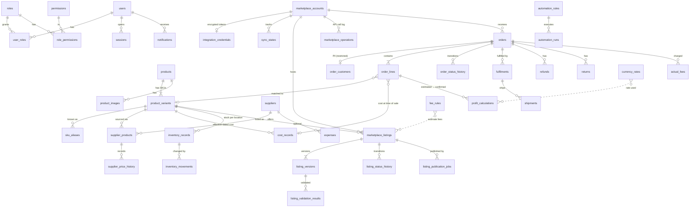

# 3. Database schema & entity relationships

Source of truth: `apps/api/prisma/schema.prisma` and the versioned SQL migrations in
`apps/api/prisma/migrations/`. Migrations are applied with `prisma migrate deploy` in every
environment; constraints that Prisma's DSL cannot express are written as SQL in the migrations.

## 3.1 Conventions

* UUID primary keys; permanent human-readable numbers where people need them
  (`products.product_number` → `FRP-000123`, `orders.order_number`). Numbers are never reused.
* Money: `DECIMAL(14,4)` + `CHAR(3)` ISO currency column. FX rates `DECIMAL(18,8)`.
* Financial and listing history is **append-only or effective-dated**: cost records, supplier price
  history, listing versions, status history, inventory movements, profit calculations, audit log.
* Marketplace-specific content is JSONB per listing version (validated by Zod in the API).

## 3.2 Entity-relationship diagram

## 3.3 Entities (spec §11 mapping)

| Spec entity | Table(s) | Key constraints |
|---|---|---|
| Users, Roles, Permissions | `users`, `roles`, `permissions`, `role_permissions`, `user_roles`, `sessions` | unique email; session token stored as SHA-256 hash |
| Products, variations, SKUs | `products`, `product_variants`, `sku_aliases` | `product_number` unique; **SKU unique case-insensitively** (`lower(sku)` index); alias unique per (type, scope) |
| Suppliers, supplier products, price history | `suppliers`, `supplier_products`, `supplier_price_history` | one row per (supplier, SKU); `priority` 1 = primary, 2+ = backups |
| Inventory records & movements | `inventory_records`, `inventory_movements` | unique (SKU, location); CHECK no bucket < 0; movement quantity > 0; idempotency key unique |
| Marketplace accounts, credentials, sync state | `marketplace_accounts`, `integration_credentials`, `sync_states` | AES-256-GCM ciphertext + IV + auth tag |
| Listings, versions, drafts, validation, publication jobs | `marketplace_listings`, `listing_versions`, `listing_validation_results`, `listing_status_history`, `listing_publication_jobs`, `listing_templates` | unique (account, marketplace SKU) and (account, external id); CHECK `ACTIVE`/`PAUSED` ⇒ external id; job idempotency key unique |
| Marketplace operation log | `marketplace_operations` | indexed by account/time and entity |
| Orders, lines, status history | `orders`, `order_customers`, `order_lines`, `order_status_history` | unique (account, external order id), (order, external line id); quantity > 0 |
| Fulfilment, shipping & tracking | `fulfilments`, `shipments` | dispatch requires `confirmed_at` + `confirmed_source` |
| Refunds, returns | `refunds`, `returns` | unique external ids per order |
| Cost records | `cost_records` | **partial unique index: one open record per SKU**; CHECK `effective_to > effective_from`; amounts ≥ 0 |
| Fee rules, actual fees | `fee_rules`, `actual_fees` | actual fees unique on (source, external_ref) → imports are idempotent |
| Currency rates | `currency_rates` | unique (base, quote, as_of, source); rate > 0 |
| Expenses | `expenses` | `attributed_to_orders` flag prevents double counting |
| Profit calculations | `profit_calculations` | full breakdown JSON + rate used; `is_current` per line |
| Automation | `automation_rules`, `automation_runs` | rules disabled by default; `requires_approval` |
| Notifications | `notifications` | to a user, a role, or everyone |
| Audit | `audit_logs` | **trigger blocks UPDATE/DELETE** |
| Settings | `system_settings` | typed values validated in the API |
| Imports | `import_jobs`, `import_rows` | unique (job, row number); per-row status enables resuming without repeating successful rows |
| Saved views | `saved_views` | unique (user, page, name) |

## 3.4 Indexing for scale

| Query | Index |
|---|---|
| Search by title / SKU (20k+ products) | GIN trigram on `products.title`, `product_variants.sku` |
| SKU exact match | unique `lower(sku)` |
| Listings by status / marketplace | `(status)`, `(marketplace, status)`, `(variant_id)` |
| Orders by date / dispatch deadline | `(ordered_at)`, `(status, dispatch_by)` |
| Cost in effect | `(variant_id, effective_from)` + partial unique open record |
| Due jobs | `(status, next_attempt_at)` |
| Audit by entity / actor | `(entity_type, entity_id)`, `(actor_id, created_at)`, `(created_at)` |

## 3.5 Transactions & concurrency

| Operation | Mechanism |
|---|---|
| Stock movement | transaction + `SELECT … FOR UPDATE` on the inventory row + CHECK constraint + idempotency key |
| Cost change | transaction + `pg_advisory_xact_lock(hash('cost:'||variant))`; closes the open record and inserts the new one atomically |
| Listing state change | transaction + row lock; state machine validates the transition |
| Publication job | atomic claim (`UPDATE … WHERE status='QUEUED'`), idempotency key per version/operation |
| Order import (Phase 4) | upsert on (account, external order id); fee import on (source, external ref) |

## 3.6 Data retention (UK GDPR)

* Customer PII is isolated in `order_customers`, **encrypted field by field** (AES-256-GCM), readable
  only with `orders.customer_pii`, and every read is audited. An hourly job clears it at
  `purge_after`: Amazon orders ≤ 30 days after delivery (Amazon Data Protection Policy, capped at
  30), other marketplaces after `privacy.customer_data_retention_days` (default 90) from delivery.
  The financial record is kept.
* Sessions expire (idle 2h, absolute 12h by default) and are revocable.
* Audit logs are retained for 7 years for financial traceability (configurable), then archived.
