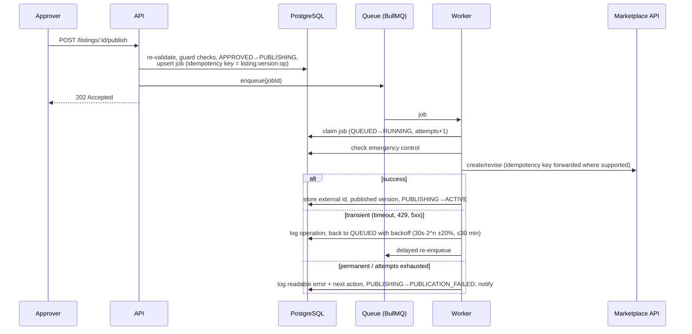
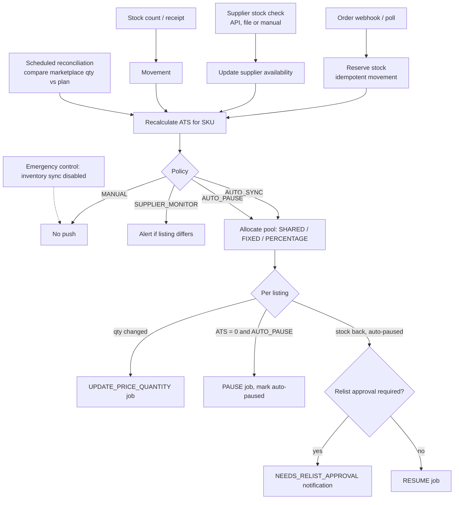

# 7. Listing lifecycle & inventory synchronisation

## 7.1 Listing lifecycle

Implementation: `packages/core/src/listing-lifecycle.ts` (pure state machine, unit tested) used by
`apps/api/src/listings/listings.service.ts`. Every transition writes `listing_status_history` and
an audit entry.

```mermaid
stateDiagram-v2
  [*] --> INCOMPLETE: create from master product
  INCOMPLETE --> DRAFT: SAVE (all required fields present)
  DRAFT --> INCOMPLETE: SAVE (required field removed)
  INCOMPLETE --> VALIDATION_FAILED: VALIDATE_FAIL
  DRAFT --> VALIDATION_FAILED: VALIDATE_FAIL
  VALIDATION_FAILED --> DRAFT: VALIDATE_PASS / SAVE
  DRAFT --> AWAITING_APPROVAL: SUBMIT [listings.submit, no errors]
  AWAITING_APPROVAL --> APPROVED: APPROVE [listings.approve, no blocking warnings,<br/>compliance signed off, not self-approval]
  AWAITING_APPROVAL --> DRAFT: REJECT (reason required) / any edit
  APPROVED --> DRAFT: REJECT / any edit (approval withdrawn)
  APPROVED --> PUBLISHING: PUBLISH [listings.publish, account connected,<br/>publishing enabled]
  PUBLISHING --> ACTIVE: MARKETPLACE_CONFIRMED (system only, external id stored)
  PUBLISHING --> PUBLICATION_FAILED: MARKETPLACE_FAILED (system only)
  PUBLICATION_FAILED --> PUBLISHING: RETRY
  PUBLICATION_FAILED --> DRAFT: REVISE / edit
  ACTIVE --> PAUSED: PAUSE (confirmed by marketplace)
  PAUSED --> ACTIVE: RESUME (confirmed by marketplace)
  ACTIVE --> ENDED: END (confirmed by marketplace)
  PAUSED --> ENDED: END
  ACTIVE --> DRAFT: REVISE (new version; live version untouched until republished)
  ENDED --> DRAFT: REVISE
  DRAFT --> ARCHIVED: ARCHIVE
  ENDED --> ARCHIVED: ARCHIVE
  PUBLICATION_FAILED --> ARCHIVED: ARCHIVE
```



### Guarantees

| Rule | Where enforced |
|---|---|
| Only the marketplace integration can move a listing to `ACTIVE` or `PUBLICATION_FAILED` | state machine (`system` actor) |
| `ACTIVE`/`PAUSED` listings always have a marketplace listing id | PostgreSQL CHECK constraint |
| Drafts are saved without publishing; nothing leaves the platform before `PUBLISH` | workflow |
| Editing a submitted/approved draft withdraws the approval | `SAVE` from `AWAITING_APPROVAL`/`APPROVED` → `DRAFT` |
| Restricted products need an approver's compliance sign-off | `RESTRICTED_PRODUCT` blocking warning + guard |
| Blocking warnings (unverified claims, promotional wording, below minimum profitable price) stop approval and publication | guard `BLOCKING_WARNINGS` |
| Emergency control stops publishing; queued jobs wait, nothing is deleted | guard + job processor |
| Failed publications stay visible with a readable reason, next action and retry | `marketplace_operations`, `last_error` |
| Publishing an unconnected account is refused up-front (listing stays `APPROVED`) | `ACCOUNT_NOT_CONNECTED` |

### Versions and field ownership

Content is stored per immutable `listing_versions` row (title, description, bullets, category,
condition, attributes, image order, policies, identifiers, keywords). Drafts are the current
unpublished version; `published_version_id` points at what is live. Changing the master product
never rewrites listing content. The operator pulls chosen fields from the master on demand
(`POST /listings/:id/sync-from-master { fields: [...] }`), so which fields are shared is an explicit
decision per listing.

### Publication job flow



Bulk publishing first returns a **preview** (number of listings, per account and environment,
currency and total listed value, ineligible items with reasons) plus a confirmation token that
hashes `(listing, version, price, account)`. If anything changes before confirmation, the token is
rejected (`PREVIEW_STALE`) and the user must review again.

## 7.2 Inventory synchronisation

Implementation: `packages/core/src/inventory.ts` (availability and sync planning, unit tested),
`apps/api/src/inventory/inventory.service.ts` (movements). The push of quantities to marketplaces
runs in the worker once connectors are live (Phase 4).

### Stock model

* **Physical stock** is held in disjoint buckets per SKU and location: `available`, `reserved`,
  `committed`, `damaged`, `returned`, plus `safety_stock`. Every change is an
  `inventory_movements` row (`RECEIVE`, `RESERVE`, `RELEASE`, `COMMIT`, `SHIP`, `RETURN`,
  `RESTOCK`, `DAMAGE`, `ADJUST_UP/DOWN`, …) applied under a row lock; an idempotency key prevents
  repeated adjustments; CHECK constraints prevent negative stock.
* **Dropship availability** lives on `supplier_products` (status, reported quantity, source,
  checked-at, manually-verified-at) and is **never** written into owned stock.

```
Physical ATS = max(0, available − safety_stock)

Dropship ATS = 0                                    if data older than staleAfterHours (default 48h) or never checked
             = 0                                    if status OUT_OF_STOCK / DISCONTINUED / UNKNOWN
             = defaultWhenUnreported (3)            if IN_STOCK without a number
             = clamp(floor(reported × buffer%) − bufferUnits, 0, maxAdvertised)
               (defaults: 50%, 2 units, max 10)
```

### Sync engine



Rules: a listing paused by a person is never resumed automatically; resumes of auto-paused
listings can require approval; marketplace webhooks are used where available with scheduled
reconciliation as the fallback; all pushes are idempotent jobs with retry, rate-limit handling and
a failed-job view.
